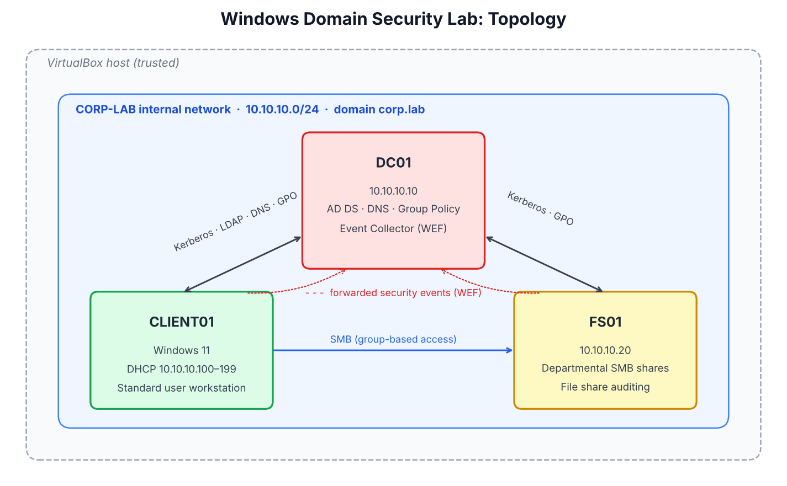

# Windows Domain Security Lab

An isolated Active Directory home lab built in Oracle VirtualBox to practice
**identity security, Group Policy hardening, audit logging and threat modelling**
for a small enterprise Windows domain (`corp.lab`).



> **Project status:** Design and documentation phase complete. Hands-on test execution
> is in progress; results are tracked in [`docs/test-results.md`](docs/test-results.md).

---

## Objectives

- Build a minimal Windows domain: domain controller, file server and workstation
- Apply a security baseline with Group Policy (password, lockout, Restricted Groups, hardening)
- Configure Advanced Audit Policy and central event forwarding
- Model threats with a simple **Asset → Threat → Control** method
- Validate each control with a repeatable test case and record the findings

## Lab Environment

| Host | Role | Address | OS |
| :--- | :--- | :--- | :--- |
| DC01 | Domain controller, DNS, Group Policy, event collector | 10.10.10.10 | Windows Server |
| FS01 | File server with departmental SMB shares | 10.10.10.20 | Windows Server |
| CLIENT01 | Domain workstation | DHCP 10.10.10.100–199 | Windows 11 |

- **Hypervisor:** Oracle VirtualBox, internal network `CORP-LAB` (10.10.10.0/24)
- **Domain:** `corp.lab`
- No production systems, real credentials or public-facing services are used.

## Documentation Map

| Document | Contents |
| :--- | :--- |
| [Asset inventory](architecture/asset-inventory.md) | Systems, security boundaries, data classification |
| [Network plan](architecture/network-plan.md) | Address plan, trust assumptions, limitations |
| [Threat model](docs/threat-model.md) | Assets, threat actors, trust boundaries, threat matrix T-01 to T-07 |
| [Security controls](docs/security-controls.md) | OU/GPO structure and threat-to-control mapping |
| [Audit policy](docs/audit-policy.md) | Advanced Audit Policy subcategories per host |
| [Hardening checklist](docs/hardening-checklist.md) | Step-by-step baseline for DC01, FS01, CLIENT01 |
| [Attack path analysis](docs/attack-path-analysis.md) | How threats chain together and which control breaks each step |
| [Event log analysis](docs/event-log-analysis.md) | Key event IDs, PowerShell review queries, detection logic |
| [Test results](docs/test-results.md) | Test cases TC-01 to TC-08 and their status |
| [Findings](docs/findings.md) | Issues found and remediation status |

## Threat Coverage

| ID | Threat | Preventive control | Detective control |
| :--- | :--- | :--- | :--- |
| T-01 | Password guessing | Account lockout | 4625 / 4740 |
| T-02 | Weak passwords | Password policy | 4723 / 4724 |
| T-03 | Local admin escalation | Restricted Groups | 4732 |
| T-04 | Privileged group change | Separate admin accounts | 4728 / 4756 |
| T-05 | Log tampering | Event forwarding | 1102 / 4719 |
| T-06 | GPO modification | Least privilege | 5136 |
| T-07 | Unauthorized share access | Group-based permissions | 5140 / 5145 |

## Repository Structure

```text
windows-domain-security-lab/
├── architecture/
│   ├── asset-inventory.md
│   ├── lab-diagram.png
│   └── network-plan.md
├── docs/
│   ├── attack-path-analysis.md
│   ├── audit-policy.md
│   ├── event-log-analysis.md
│   ├── findings.md
│   ├── hardening-checklist.md
│   ├── security-controls.md
│   ├── test-results.md
│   └── threat-model.md
├── LICENSE
└── README.md
```

## Skills Demonstrated

Active Directory · Group Policy · Windows Security Auditing · PowerShell ·
Threat Modelling · Security Documentation · Virtualization

## Roadmap

- [x] Network plan, asset inventory and threat model
- [x] Control design, audit policy and hardening checklist
- [ ] Execute test cases TC-01 to TC-08 and attach sanitized evidence
- [ ] Record findings and remediation
- [ ] Iteration 2: network segmentation, second domain controller, Sysmon

## Disclaimer

This lab is for learning purposes only and runs in an isolated virtual network.
All screenshots and exports are sanitized before publishing.

## License

[MIT](LICENSE)
